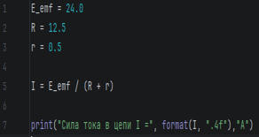
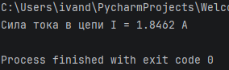

ФЕДЕРАЛЬНОЕ ГОСУДАРСТВЕННОЕ АВТОНОМНОЕ ОБРАЗОВАТЕЛЬНОЕ УЧРЕЖДЕНИЕ ВЫСШЕГО ОБРАЗОВАНИЯ 

«ОМСКИЙ ГОСУДАРСТВЕННЫЙ ТЕХНИЧЕСКИЙ УНИВЕРСИТЕТ» 

Кафедра «  Автоматизация и робототехника» 

# **ОТЧЕТ по лабораторной работе № 1 Вариант №9** 

Выполнил: 

студент группы УТС-251т Доронин И.П. 

(дата, подпись) 

Проверил: 

Доц., к.н. Ситников Д.В 

(дата, подпись) 

Омск 2026 

# **Цель работы** 

Изучить основы программирования на языке Python, освоить работу с переменными, константами, арифметическими выражениями и форматированным выводом результатов. 

# **Теоретические сведения** 

Язык Python является интерпретируемым. При первом запуске код транслируется в промежуточный байт-код и выполняется виртуальной машиной (CPython). Переменные представляют собой ссылки (имена), связанные с объектами в динамической памяти. Отступы (ровно 4 пробела) обязательны и служат для группировки блоков кода. Метод format() позволяет выполнять форматирование в соответствии со спецификацией PEP 3101. Например, выражение '{0:.3f}'.format(pi) форматирует вещественное число с точностью до трех знаков после запятой. 

# **Индивидуальное задание и его выполнение** 

**Суть задания:** Написать программу для вычисления силы тока в полной электрической цепи по формуле: 


<!-- Start of picture text -->
Закон Ома для полной цепи: |= E_emf /(R +r)
Используя следующие данные: 
E_emf = 24.0, R = 12.5, r = 0.5

# **Код выполненного задания и пояснения к нему:** 
```python
E_emf = 24.0 R = 12.5 r = 0.5 

I = E_emf / (R + r) 

print("Сила тока в цепи I =", format(I, ".4f"),"А") 
```
print() - выводит информацию на экран. 

format(I, ".4f") - форматирует число: 

- I - какое число форматируем; 

- .4f - вывести 4 знака после запятой. 


# **Запуск кода:** 






# **Заключение и вывод** 

В ходе лабораторной работы были изучены основные элементы синтаксиса языка Python: переменные, арифметические операции и форматированный вывод данных. Была написана программа для расчёта силы тока в электрической цепи по заданной формуле. В результате расчёта получено значение **I = 1,8462 А** . Полученные навыки позволяют использовать Python для решения простых расчётных задач. 


