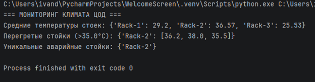

ФЕДЕРАЛЬНОЕ ГОСУДАРСТВЕННОЕ АВТОНОМНОЕ ОБРАЗОВАТЕЛЬНОЕ УЧРЕЖДЕНИЕ ВЫСШЕГО ОБРАЗОВАНИЯ

  
«ОМСКИЙ ГОСУДАРСТВЕННЫЙ ТЕХНИЧЕСКИЙ УНИВЕРСИТЕТ»
  
Кафедра «Автоматизация и робототехника»
  
**ОТЧЕТ**
  
**по лабораторной работе № 3**
  
**Вариант №9**
  
Выполнил:
  
студент группы УТС-251т Доронин И.П.

  
(дата, подпись)
  
Проверил:
  
Доц., к.н. Ситников Д.В

  
(дата, подпись)
  
Омск 2026
  
**Цель работы**
  
Изучить принципы создания и использования собственных модулей в Python, научиться обрабатывать данные с помощью функций, работать со словарями и множествами, а также использовать аргументы командной строки.

  
**Теоретические сведения**
  
Модуль в Python — это файл с программным кодом, содержащий функции, переменные и другие объекты. Модули позволяют разделять программу на отдельные части и повторно использовать написанный код.

  
Для подключения модуля применяется оператор import. Для передачи аргументов командной строки используется модуль sys, а список переданных аргументов доступен через sys.argv.

  
Словари позволяют хранить данные в формате «ключ — значение». Множества (set) используются для хранения уникальных элементов без повторений.

  
**Индивидуальное задание**
  
Разработать программу для мониторинга температуры серверных стоек центра обработки данных.

  
Необходимо реализовать следующие функции:
  
find\_hotspots(rack\_dict, max\_temp=35.0) — определяет стойки, в которых температура превышает заданный предел.

  
get\_rack\_averages(rack\_dict) — вычисляет среднюю температуру каждой стойки.

  
get\_unique\_warnings(warning\_events) — формирует множество уникальных стоек с аварийными событиями.

  
Главная программа должна получать допустимую температуру из аргументов командной строки, использовать профиль температур серверных стоек и выводить результаты анализа.

  
**Разработка программы**
  
Программа состоит из двух файлов: variant\_mod.py, содержащего основные функции обработки данных, и main.py, отвечающего за запуск и вывод результатов.

  
**Файл variant\_mod.py**

  
def find\_hotspots(rack\_dict, max\_temp=35.0):

  
"""Находит стойки с превышением допустимой температуры."""

  
hotspots = {}
  
for rack, temperatures in rack\_dict.items():

  
overheating = \[
  
temp for temp in temperatures
  
if temp > max\_temp
  
\]
  
if overheating:
  
hotspots\[rack\] = overheating
  
return hotspots
  
def get\_rack\_averages(rack\_dict):
  
"""Вычисляет среднюю температуру каждой стойки."""

  
averages = {}
  
for rack, temperatures in rack\_dict.items():

  
if temperatures:
  
averages\[rack\] = round(
  
sum(temperatures) / len(temperatures), 2
  
)
  
return averages
  
def get\_unique\_warnings(warning\_events):
  
"""Возвращает множество уникальных аварийных стоек."""

  
return {
  
event\["rack\_id"\]
  
for event in warning\_events
  
}
  
**Файл main.py**

  
import sys
  
from variant\_mod import (
  
find\_hotspots,
  
get\_rack\_averages,
  
get\_unique\_warnings
  
)
  
def main():
  
max\_temp = 35.0

  
if len(sys.argv) > 1:

  
try:
  
max\_temp = float(sys.argv\[1\])

  
except ValueError:
  
print("Ошибка: предел температуры должен быть числом.")

  
return
  
racks = {
  
'Rack-1': \[28.5, 29.0, 30.1\],

  
'Rack-2': \[36.2, 38.0, 35.5\],

  
'Rack-3': \[25.0, 26.1, 25.5\]

  
}
  
averages = get\_rack\_averages(racks)
  
hotspots = find\_hotspots(racks, max\_temp)
  
warning\_events = \[
  
{"rack\_id": rack}
  
for rack in hotspots
  
\]
  
unique\_warnings = get\_unique\_warnings(warning\_events)

  
print("=== МОНИТОРИНГ КЛИМАТА ЦОД ===")
  
print("Средние температуры стоек:", averages)
  
print(
  
f"Перегретые стойки (>{max\_temp}°C):",
  
hotspots
  
)
  
print("Уникальные аварийные стойки:", unique\_warnings)

  
if \_\_name\_\_ == "\_\_main\_\_":
  
main()
  
**Анализ работы программы**
  
После запуска главной программы выполняется импорт функций из модуля variant\_mod.py. Далее задаётся допустимый температурный предел. Если пользователь не передал собственное значение, используется стандартное значение 35 °C.

  
Затем создаётся словарь с температурными показателями трёх серверных стоек. С помощью функции get\_rack\_averages() рассчитывается средняя температура каждой стойки.

  
Функция find\_hotspots() сравнивает полученные значения с установленным пределом и определяет зоны перегрева. Функция get\_unique\_warnings() формирует множество стоек, для которых были обнаружены аварийные события, исключая повторения.

  
**Результат выполнения программы**
  
При запуске программы со стандартным значением температуры 35 °C получаем:

  
В результате выполнения программы установлено, что стойка Rack-2 имеет превышение допустимой температуры. Средняя температура в ней составляет 36,57 °C. Остальные стойки работают в пределах установленного температурного ограничения.

  
**Вывод**
  
В ходе лабораторной работы были изучены принципы создания и подключения собственных модулей Python. Были разработаны функции для вычисления средней температуры серверных стоек, определения зон перегрева и поиска уникальных аварийных событий.

  
Также были освоены работа со словарями и множествами, обработка аргументов командной строки и организация программы из нескольких файлов. Поставленная цель работы достигнута.
